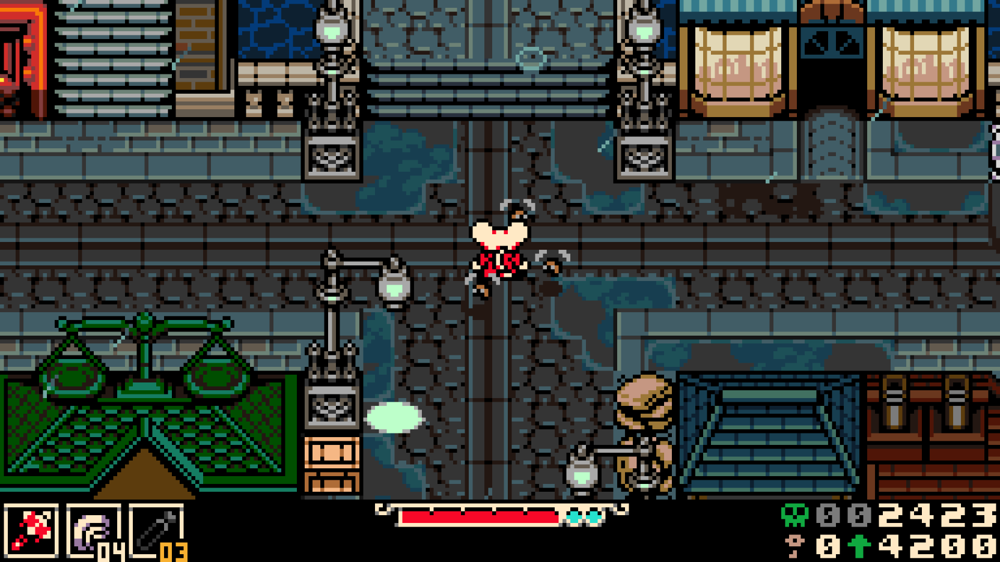
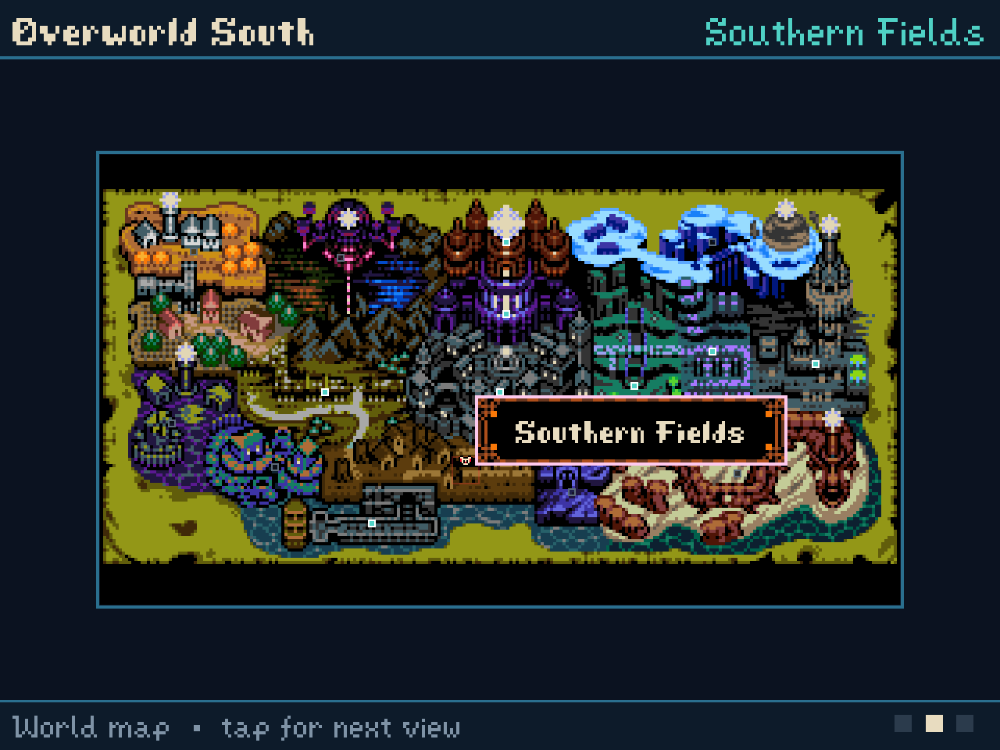
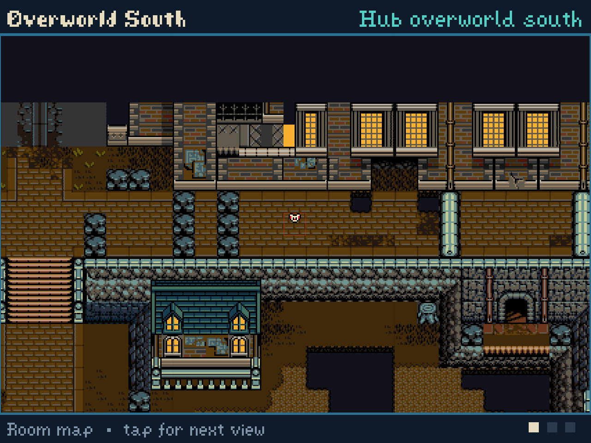
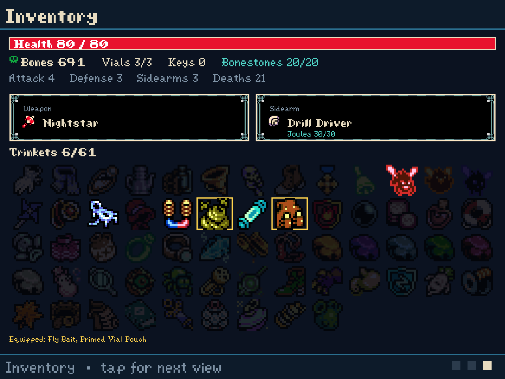

# Mina the Hollower on Android

An experimental port that runs the **macOS (arm64) build of *Mina the Hollower*** on **Android (arm64-v8a)**,
with a **live map on the second screen** of dual-screen handhelds such as the Retroid Pocket Duo.

There is no source code for the game. Instead, the original Mach-O binary is loaded as-is by an Android
build of the open-source [machismo](https://github.com/bmdhacks/machismo) loader, the helper libraries it
needs are loaded into bionic through a glibc compatibility layer, and a small SDL/EGL shim provides
graphics. Everything in this repository is glue, tooling and documentation; **no game data or game assets are
included**.

> **Status: working prototype.** It boots, loads a real PC save and plays on a Retroid Pocket Duo and on an
> Android emulator, and the second screen shows a live map. On the Duo, sound, the controls and moving between
> areas were confirmed working by hand. Frame rate and long-session stability are **not yet measured**
> (see [Status](#status)).

<p align="center">
  
  
</p>
<p align="center"><em>Retroid Pocket Duo (Adreno 722, OpenGL ES 3.2): game on the top screen, live world map with a
position marker on the bottom screen. Screenshots taken with <code>adb screencap</code> per display.</em></p>

## What works

| Area | State |
|---|---|
| Loading the macOS game binary on Android (machismo as a library, 64 MiB guest stack, LSE/RCPC patching) | Works |
| glibc libraries in a bionic process (`libglibc_compat`, renamed `libstdc++`/`libc++`/`libgcc_s`) | Works |
| Rendering through GLES 3.1+ (SDL owns the GL context, shader corpus converted from the game's data) | Works on Adreno 722 and on the emulator with a host GPU |
| Title, profile and name entry, menus, feats, inventory | Works (emulator) |
| Loading a **PC Steam save** (`saveData.yc`) | Works (the save format is identical) |
| Walking in the Ossex hub with the loaded save | Works (device and emulator) |
| Audio, controls and moving between areas | Works on the Duo (confirmed by hand) |
| Live player position and area read from game memory (10 Hz) | Works |
| Second-screen **world map** with a marker for the current location (17 locations) | Works on device and emulator |
| Second-screen **room view** (coloured level art around the player, unvisited areas dimmed) and **inventory** (health, weapon, sidearm, trinkets, counters read live from the save slot) | Works on the Duo |
| Panel drawn with the game's own UI font, location plates and marker, at the display frame rate while moving | Works on the Duo |
| Crash hunt on the emulator | 0 crashes in about 45 minutes, but the tester stayed inside one courtyard pocket |

Details, with the evidence for each, are in [`docs/STATUS.md`](docs/STATUS.md).

## Status

Honest summary of what has and has not been tested.

**Verified**
- Retroid Pocket Duo (Android 16): installs, starts, renders at 1920x1080, tracks the player, shows the
  world map on the real second display. Confirmed by hand on the device: **audio, the controls, and
  moving between different areas**.
- Android x86_64 emulator (ARM translation, host GPU): the full flow from logo to gameplay, menus, save
  loading, about 45 minutes of automated walking and menu cycling without a crash, memory flat at ~1.2 GB.
- Map marker order verified for three locations by changing the area id in memory and checking where the
  marker lands (`docs/screenshots/09-map-marker-teleport-test.png`).

**Not verified**
- Battery on the device. Measured so far: the panel costs about 5% of one CPU core (was about 20% before it only
  redraws while you move); the game threads use about 27%. GPU load was not measurable.
- Boss fights and long sessions. The area transitions and the second-screen views after them were only
  checked by playing, not with automated crash logging.
- The room view uses the game's tile art with the global palette. Water colours are a guess except in the bayou,
  world-state layer variants and animated tiles are not drawn, and unbaked levels fall back to the nearest baked one.
- Weapon upgrade level and per-area completion are not shown in the inventory (not decoded yet).
- The location order for the other 14 map locations is derived from the game's static data and checked for
  three of them.

The build is a **debug** build (targetSdk 28 so that the runtime may map anonymous RWX memory, arm64 only).
Expect crashes.

## The second screen

Dual-screen devices expose the lower screen as a `DISPLAY_CATEGORY_PRESENTATION` display. `MinaActivity`
shows a `Presentation` there containing `MapView`. A native thread in `apk/native/libmain.c` finds the
player object in the guest's memory and publishes the position, area id, map flags and active level names to
Java over JNI. Tapping the panel cycles three views:

| View | What it shows |
|---|---|
| **Room** | The game's own tile art around the player (1 pixel = 0.1 world unit), visited and nearby cells lit, the rest dimmed, with Mina's marker |
| **World map** | The game's own 17-location world map (decoded from your game data) with a marker at the current location |
| **Inventory** | Health, bones, vials, keys, bonestones, stat levels, equipped weapon and sidearm, and all 61 trinkets (owned ones lit, equipped ones outlined), read from the save slot in memory |

<p align="center">
  
  
  
</p>

How the offsets and coordinate transforms were found is documented in
[`docs/reverse-engineering/`](docs/reverse-engineering/): player and area offsets
(`position-offsets.md`), the 198-entry area table and location order (`area-table.md`), the world map
format (`map-assets.md`), the tile level format (`level-format.md`) and the world-coordinate scale of 0.1
(`level-to-world.md`).

## How it works

```
Android app (MinaActivity, SDL2)  ->  libmain.so  ->  libmachismo.so (Mach-O loader)
                                                      -> MinaTheHollower (macOS arm64 binary, unmodified)
                                                      -> libgothic_patches.so (glibc engine patches)
                                                      -> libglibc_compat.so + renamed glibc C++ runtime
                                                      -> libgfxshim_sdl.so  ->  SDL2  ->  EGL / GLES 3.x
```

See [`docs/ARCHITECTURE.md`](docs/ARCHITECTURE.md) for the loader changes (pread-based segment loading at a
fixed address, LSE patch islands, synthetic eh_frame registration), the compatibility layer and the graphics
path, and the bugs that took the longest to find.

## Repository layout

| Path | Contents |
|---|---|
| `apk/` | Gradle project (`apk/android`), native glue `apk/native/libmain.c` (loader start-up, tracker thread, JNI), build scripts |
| `machismo-android/` | machismo adapted to bionic / the NDK (see [Credits](#credits-and-licence)) |
| `android/compat/` | glibc-on-bionic compatibility layer and library patcher |
| `android/gfxshim/` | SDL/EGL interposers that let the game use SDL-owned GL |
| `android/tests/` | Atomics test and the automated walking / crash-hunt driver |
| `deploy/` | `deploy-to-device.ps1`: installs the APK and pushes game data, shaders, map art and a save over ADB |
| `tools/` | Python tools to read the game's containers and bake the map images from **your own** game data |
| `scripts/` | Build helper scripts used so far (WSL Ubuntu) |
| `docs/` | Status, architecture and reverse-engineering notes, screenshots |

## Building

You need the Android SDK and NDK 27.3, JDK 17 and, on Windows, WSL Ubuntu. The scripts were written for that
setup and contain paths you may have to adjust. In short:

1. `android/compat/build.sh` - compat layer and patched glibc libraries.
2. `machismo-android/build-android.sh` - loader (this script hides compiler errors, check `build-android/*.log`).
3. `android/gfxshim/build.sh` - graphics shim.
4. `apk/build_all.sh` - builds `libmain.so` and gathers every `.so` into `jniLibs/arm64-v8a`.
5. `scripts/mina-apk-build.sh` - Gradle debug build, producing `apk/out/Mina-debug.apk`.

**Prebuilt glibc libraries are not included.** The compat layer expects `libgothic_patches.so` (engine patches
from the PortMaster *Mina the Hollower* port), `libc++.so.1`, `libc++abi.so.1`, `libatomic.so.1` and the Ubuntu
24.04 arm64 `libstdc++.so.6` / `libgcc_s.so.1` in `android/compat/libs/`; see `android/compat/README.md`.

## Installing the game

You must own the game. The app reads from its private storage (`files/`):

- `gdroot/gamedata/Mina the Hollower.app` - the macOS bundle from your own copy.
- `gdroot/gamedata/shaders_gles`, `shaders_spv` - converted from `shaders.pak.yc` with `ycd_extract` and
  [airlift](https://github.com/bmdhacks/airlift) (see `scripts/mina-shaders.sh`).
- optional `mapassets/` - world map art, `locators_big.json`, `area_table.csv`, `levels/` - baked from your
  data with `tools/bake_map.py` and `tools/bake_levels.py`. The panel also needs the game's UI assets extracted with `tools/extract_ui.py` (font, location plates, marker) and the icons staged with `tools/stage_inv.py`, pushed to `files/mapassets/ui/`, and the coloured level art from `tools/bake_levels_color.py` in `files/mapassets/levels/`. `deploy/deploy-to-device.ps1` bakes and pushes all of it (step 7b); the inventory view additionally needs an `inventory-map.json` (`-InventoryMap`), which is not in the repo because it holds game text, and without it the panel says "No inventory data".
- optional `saveData.yc` - a PC save. Keep a backup of your original.

With a device connected over ADB, `deploy/deploy-to-device.ps1` does all of this in one go (it supports
`-WhatIf`, never deletes anything on the device and backs up an existing save to `saveData.yc.orig`).
A first-run setup activity (`apk/android/app/src/main/java/com/mina/port/SetupActivity.java`) that copies a
game folder with a progress display is written and compile-checked, but not yet wired in or run.

## Roadmap

- Measure battery and stability over a long session on the Duo; try rendering at half resolution.
- Wire in the first-run setup screen.
- Decode weapon level and per-area completion for the inventory; bake the remaining levels.
- Level lookup for all 99 levels (54 are baked; the rest have no collision layers).
- Release build, 16 KB page-size check and signing.

## Legal

- **No game data, assets, shaders, baked map art or save files are included**, and the APK contains none.
  You need your own legitimate copy of *Mina the Hollower*. All game art shown in the screenshots belongs to
  Yacht Club Games.
- This project is not affiliated with, endorsed by or sponsored by Yacht Club Games.
- The reverse-engineering notes describe memory layouts and file formats for interoperability. They contain
  no game code or assets.

## Credits and licence

- [machismo](https://github.com/bmdhacks/machismo) by bmdhacks (GPL-3.0) is the Mach-O loader at the heart of
  this port. `machismo-android/` is a modified copy based on upstream commit `75d38ca`; this repository is
  therefore licensed **GPL-3.0** (see `LICENSE`).
- [airlift](https://github.com/bmdhacks/airlift) lifts the game's Metal shaders to SPIR-V; the PortMaster
  *Mina the Hollower* port supplies the `libgothic_patches` engine patches this approach builds on.
- SDL2 (zlib licence) provides windowing, input and the Java glue.
